# Developer Portfolio with Admin Panel (PHP, MySQL)

A single-page portfolio website whose content (profile, skills, projects) lives in MySQL and is managed from a password-protected admin panel. Messages from the contact form are saved to the database and can be read in the admin panel.


Full video (1 min): [screenshots/demo.mp4](screenshots/demo.mp4)

## Why

A static portfolio has to be edited in HTML every time a new project or skill comes along. Here the page is generated from the database, so adding a project takes a minute in the admin panel and needs no code changes or redeploy.

## Features

**Website** (`index.php`)
- Hero, About, skills with progress bars grouped by category, project cards, contact form
- Filter projects by technology
- Light / dark theme (follows the system setting, remembers the choice)
- Responsive layout with a mobile menu, scroll animations

**Contact form**
- Validation on the server, Post/Redirect/Get (a page refresh never sends the form twice)
- CSRF token, honeypot field against bots, limit of 1 message per minute

**Admin panel** (`/admin`)
- Login with username and password (`password_hash`), 5 attempts then a 5-minute lockout
- Create, edit and delete projects and skills; edit the profile
- Read messages, mark as read / unread, delete; unread counter on the tab

**Security**
- PDO prepared statements everywhere (no SQL injection)
- All output escaped (no XSS); only `http(s)` links are accepted, so `javascript:` URLs never get through
- CSRF tokens on every form, session cookie `HttpOnly` + `SameSite=Lax`
- `.htaccess` blocks direct access to `config.php`, `includes/` and `database/`

## Screenshots

| Light theme | Dark theme |
| --- | --- |
| 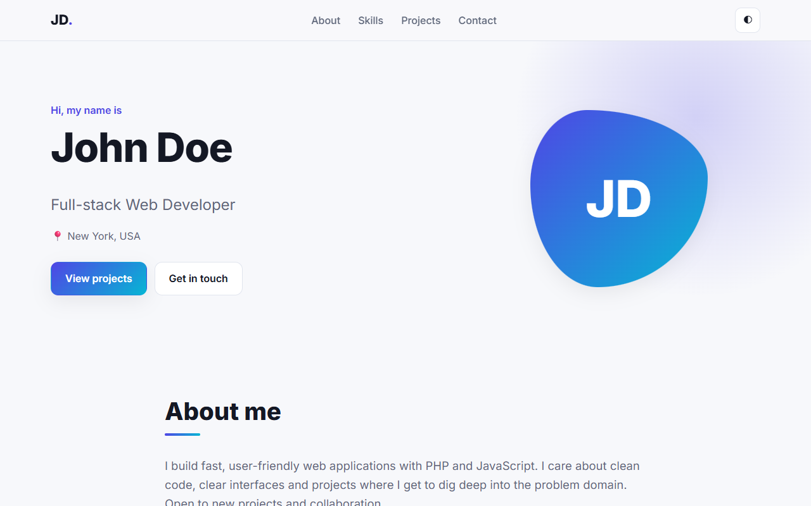 | 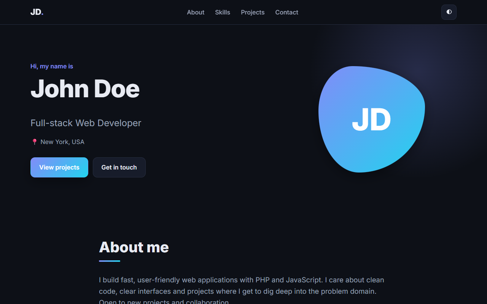 |
| 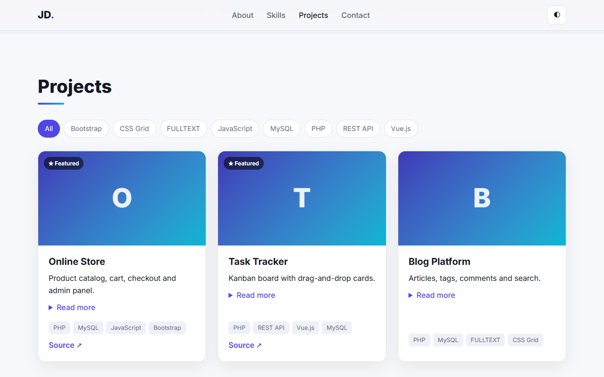 | 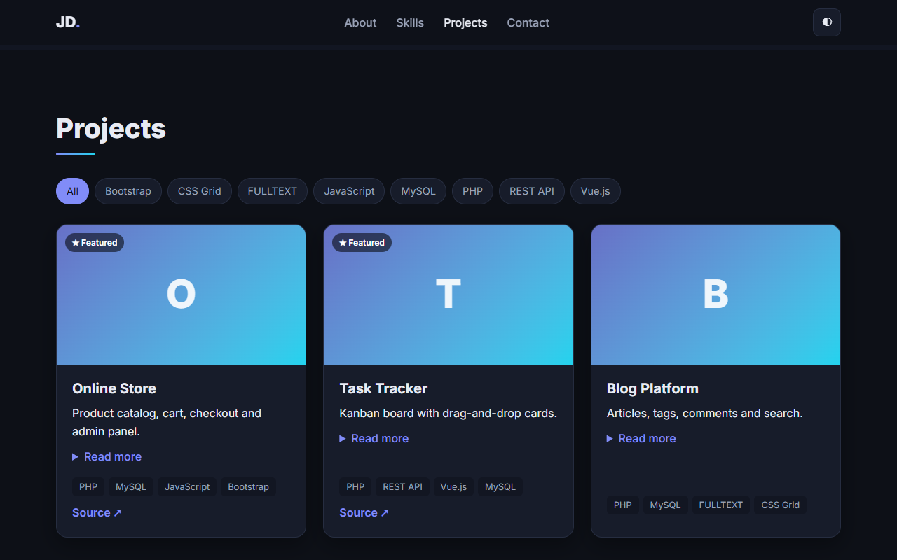 |

| Skills | Contact form |
| --- | --- |
| 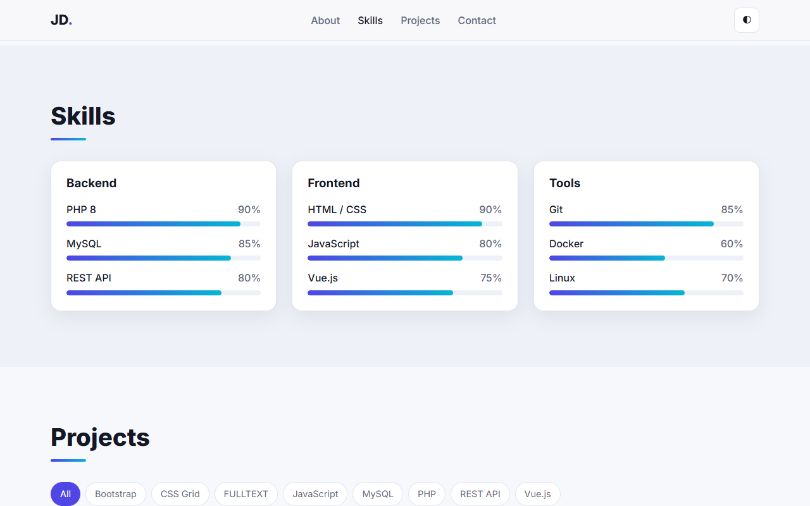 | 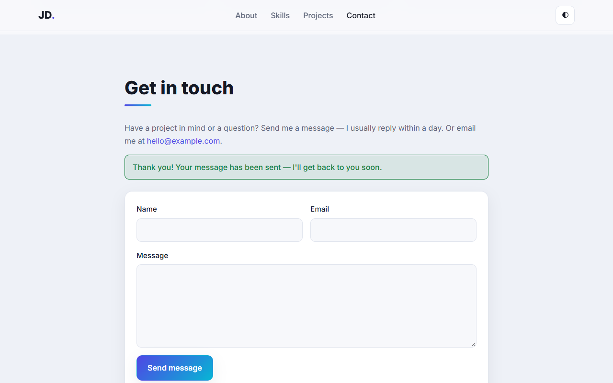 |

| Phone | Mobile menu |
| --- | --- |
| 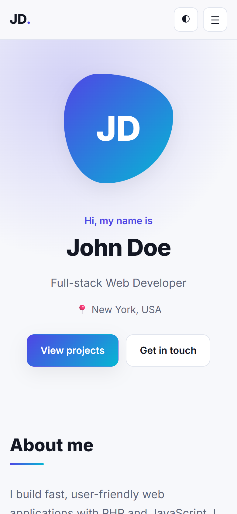 | 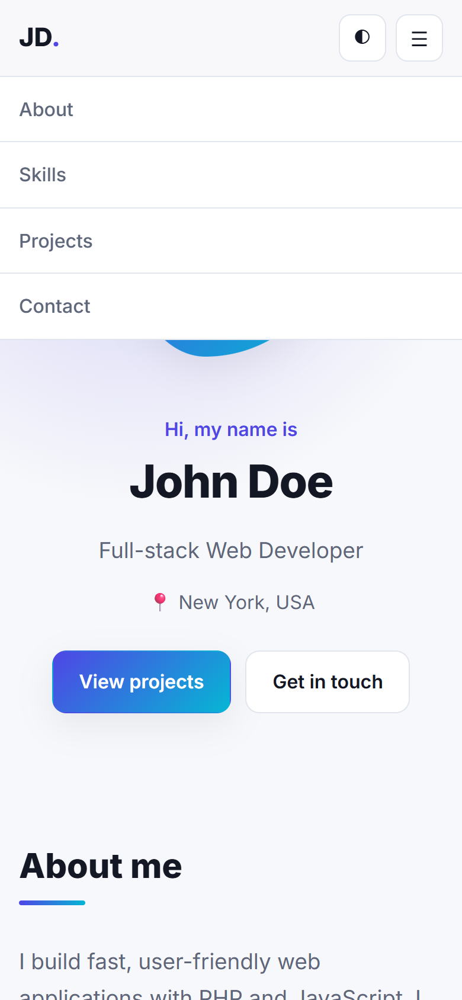 |

**Admin panel**

| Projects | Edit project |
| --- | --- |
| 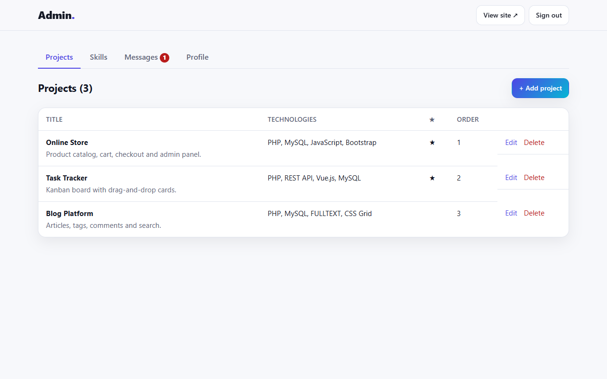 | 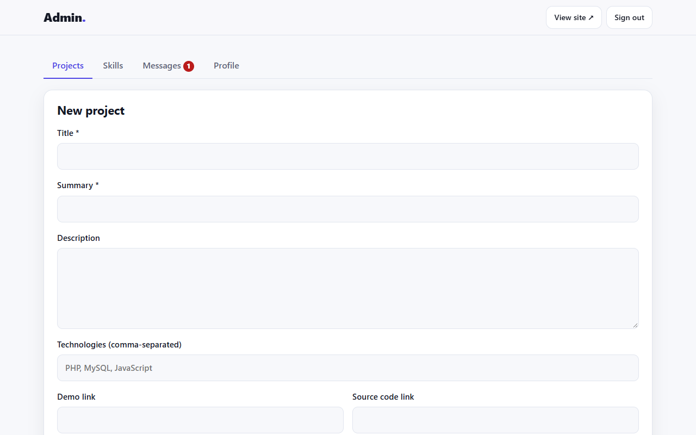 |
| **Skills** | **Messages** |
| 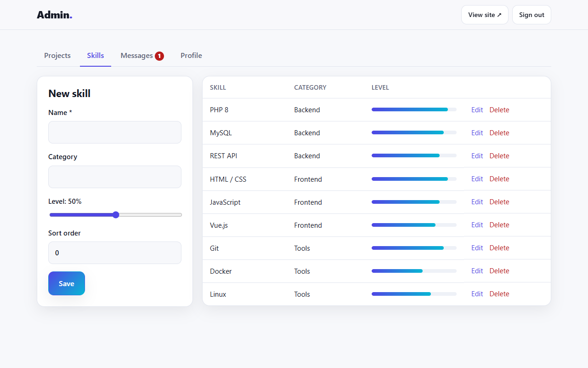 | 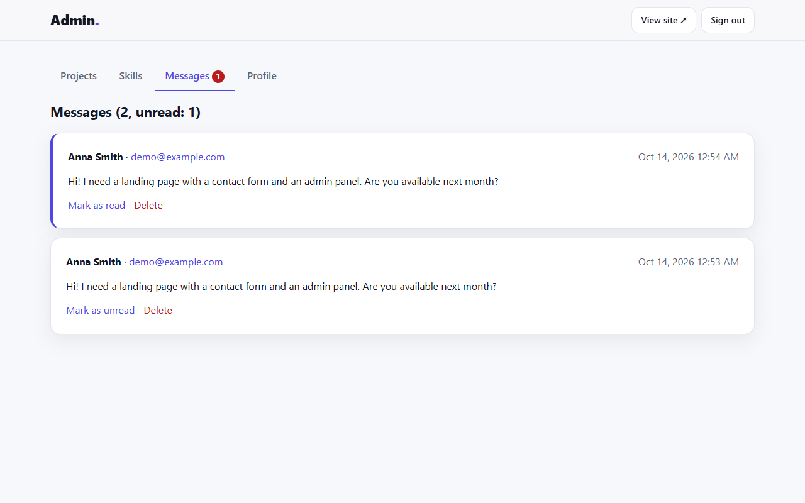 |

## Tech Stack

PHP 8, MySQL / MariaDB (PDO), HTML5, CSS3 (Grid, Flexbox, custom properties), vanilla JavaScript. No frameworks, no Composer, no build step.

## Project Structure

```
├── index.php               public page + contact form handler
├── config.example.php      database settings (copy to config.php)
├── create_admin.php        CLI script to create an administrator
├── includes/bootstrap.php  PDO connection, sessions, CSRF, helpers
├── admin/                  login.php, index.php (all admin tabs), logout.php
├── assets/css, assets/js   styles and scripts
├── database/schema.sql     tables + demo data
└── screenshots/            images and demo video for this README
```

## How to Run

Requires PHP 8.0+ and MySQL 5.7+ / MariaDB 10.3+.

**With XAMPP (Windows, macOS, Linux):**

1. Install [XAMPP](https://www.apachefriends.org/) and start **Apache** and **MySQL** in the XAMPP Control Panel.
2. Copy the project folder into `xampp/htdocs/`, for example `C:\xampp\htdocs\PHP-MySQL`.
3. Create the database: open http://localhost/phpmyadmin → **Import** → choose `database/schema.sql` → **Go**.
   Or from the command line: `mysql -u root < database/schema.sql`
4. Optional: copy `config.example.php` to `config.php` and change the database settings. The XAMPP defaults (user `root`, empty password) work without this step.
5. Create an administrator (password at least 8 characters):
   ```bash
   php create_admin.php admin YourStrongPassword
   ```
6. Open http://localhost/PHP-MySQL/ for the site and http://localhost/PHP-MySQL/admin/ for the admin panel.

**Without XAMPP**, using PHP's built-in server (MySQL still required):

```bash
php -S localhost:8000
```

PHP's built-in server ignores `.htaccess`, so use it only for local testing.

## Before Deploying

- Copy `config.example.php` to `config.php`, enter your host's database credentials and set `'debug' => false`.
- Use a dedicated MySQL user for the site instead of `root`.
- Enable HTTPS; the session cookie becomes `Secure` automatically.

## Notes

- The demo content (John Doe, the three projects) is fictional. Replace it with your own in the admin panel.
- `config.php` is in `.gitignore`, so real passwords never reach the repository.
